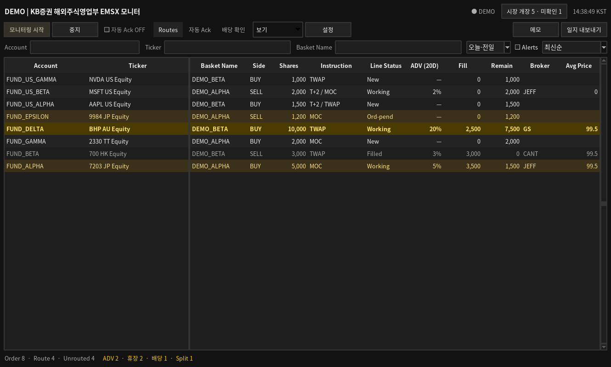
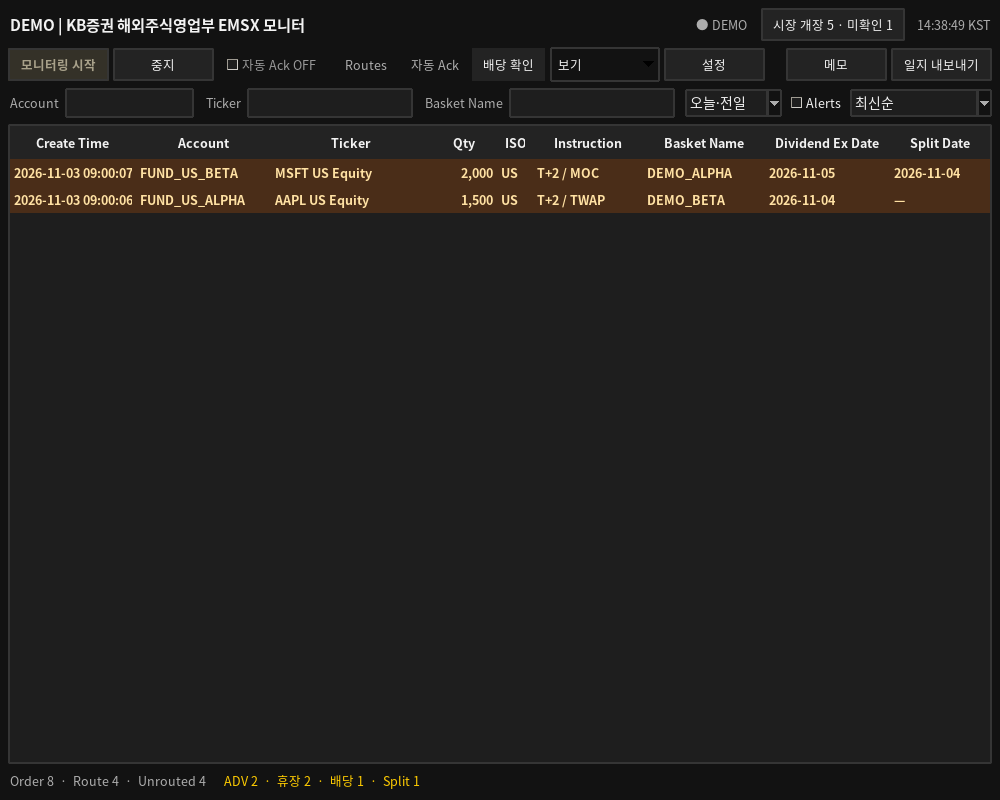
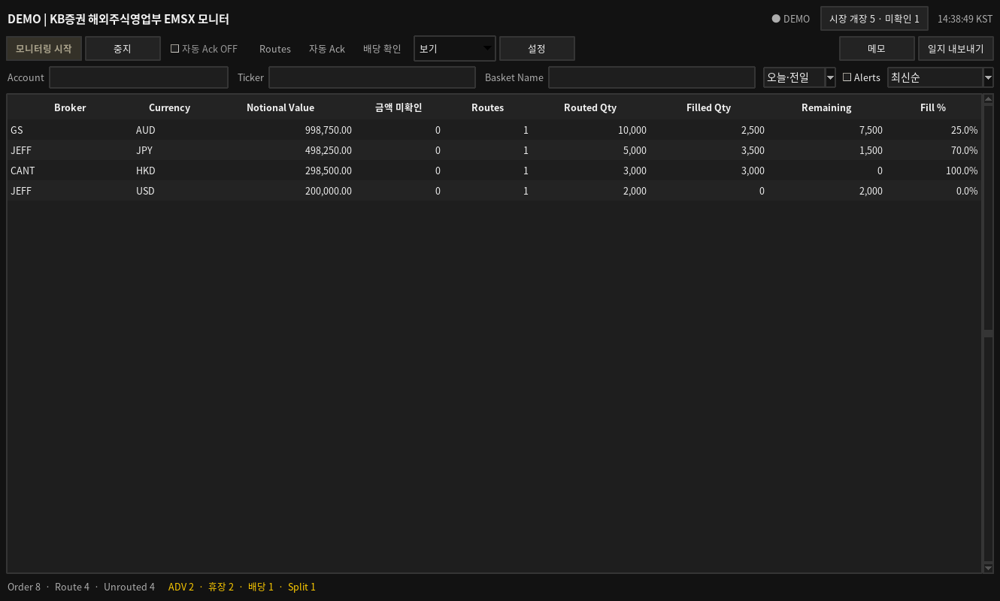

# 2.10.0 데스크 모니터 개선

## 미라우팅 Order

Routes는 실제 Route와 함께 Route가 없는 New·Pending·Ord-pend Order를 표시합니다.
Assign·Assigned·Working·Hold 상태에서도 Route가 없으면 Order를 보완해 표시합니다.
Account·Ticker·Basket Name·Shares·Instruction·Line Status와 기존 날짜·검색 필터를 유지합니다.
미라우팅 행의 Broker는 비어 있으며 상세 Route#는 `—`입니다.
실제 Route가 도착하면 미라우팅 행을 제거하고 수신한 Route별 행으로 교체합니다.
복수 Route와 취소·삭제 갱신에도 별도의 가짜 Route를 더하지 않습니다.
완료·취소 Order에 미라우팅 행을 새로 만들지 않습니다.

미라우팅 행은 실제 Route 건수와 Broker 수량·금액 집계에서 제외합니다.
경고와 음향은 기존 Order 기준으로 중복 없이 평가합니다.
Route 지연·No-Fill의 아시아 12개 ISO 제한과 MOC의 No-Fill 제외도 유지합니다.
Pending·Ord-pend 표시 자체를 FIX ACK 완료로 간주하지 않습니다.

## Split Date

**배당 확인**에 기존 8개 열과 **Split Date**를 표시합니다.
대상은 기존과 동일하게 DS290 ISO가 `US`이고 고객 Instruction에 `T+2`가 포함된 Order입니다.
`DVD_EX_DT` 또는 `EQY_SPLIT_DT`가 **현재 KST 날짜의 다음 NYSE 영업일**이면
해당 행을 강조하고 상단에 고정합니다. Split Date만 일치해도 강조합니다.
**Alerts**는 두 날짜 중 하나라도 일치한 행을 표시합니다.
주말·NYSE 휴장을 제외하며 한국 공휴일은 적용하지 않습니다.
날짜 또는 일정 미확인은 임의 날짜로 대신하지 않습니다.

`EQY_SPLIT_DT`는 기존 비동기 참조데이터 요청에 포함합니다.
필드 정보는 mnemonic으로 조회하고 ID `DV_017`·`DV017` 표기를 받아들이되
확인된 mnemonic이 `EQY_SPLIT_DT`와 정확히 일치해야 사용합니다.
EMSX 기본 구독에는 배당·Split 참조 필드를 추가하지 않습니다.
날짜 형식 오류·권한 오류·서비스 단절은 해당 날짜만 미확인으로 처리합니다.
배당·Split 강조 시작·해제는 각각 일지에 기록하며 새 자동 주문 변경은 하지 않습니다.
표 CSV는 9개 열을 저장하고 일일 Excel의 Order 현황에도 Split Date를 포함합니다.

## Broker별 Notional Value

**보기 → Brokers**에서 Broker·Currency별 Notional Value를 확인합니다.
USD·JPY 등 서로 다른 통화는 별도 행이며 환율 환산이나 통화 간 합산은 하지 않습니다.

계산은 `Filled Qty × Route Avg Price + 잔여 Qty × Limit Price`입니다.
잔여 수량의 가격은 Route Limit Price를 우선하며 Route 가격이 미제공된 경우
같은 통화의 상위 Order Limit Price를 사용합니다.
취소·완료·만료 등 종료된 Route의 잔여 수량은 금액에서 제외합니다.
순수 미체결 Limit 주문은 `Route Qty × Limit Price`, 전량 체결은 `Filled Qty × Avg Price`입니다.
GBp·GBX 호가는 100으로 나누어 GBP로 집계합니다. Route·Order의 호가 단위도 각각 적용합니다.

필요한 가격·통화가 없거나 손상된 경우, 또는 Market 주문의 잔여 가격이 미확인인 경우
해당 금액을 0이나 평균 체결가 추정값으로 대체하지 않습니다.
그 Broker·Currency에 미확인 Route가 하나라도 있으면 총액은 `—`이며
**금액 미확인** 열에 해당 Route 수를 표시합니다. 확인된 일부 금액을 전체 합계처럼 표시하지 않습니다.
Routed Qty·Filled Qty·Remaining은 기존 수량 집계입니다. 취소 잔여가 금액에 포함된다는 뜻은 아닙니다.

`EMSX_CURRENCY`·`EMSX_LIMIT_PRICE`는 Order·Route별 선택 구독으로 분리했습니다.
필드 거부는 기본 수신과 자동 Ack에 전파하지 않고 금액 확인을 보류합니다.
부분 갱신은 기존 Route를 갱신하므로 같은 누적 체결을 반복 합산하지 않습니다.
Broker CSV에 통화·금액·미확인 건수를 포함하고 일일 Excel Route 현황에도 통화·금액을 저장합니다.

## 자동 Ack 토글

조작부의 **자동 Ack ON/OFF** 토글 하나로 제어합니다.
앱의 기본 선택은 ON이며 Order·Route 초기 수신 완료 직후 작업자에서 한 번 활성화를 시도합니다.
추가 활성화 확인창·별도의 해제 버튼·설정의 자동 Ack 조건 버튼은 제거했습니다.
DEMO에서는 OFF이며 전송하지 않습니다.

기존 관리자 설정의 전송 허용 값은 자동 변경하지 않습니다.
팀·환경·전송 허용·수량·필수 필드·날짜·중복 예약·감사 저장 검사를 통과해야 실제 전송합니다.
미허용 설정은 Event Log에 사유를 남기고 OFF로 표시하며 자동 재시도하지 않습니다.
초기 스냅샷·활성화 전 기존 Order는 자동 Ack하지 않고 활성화 후 신규 적격 Order만 단일 배치로 전송합니다.
중복 ON 요청은 이미 모은 배치를 지우지 않습니다.
초기 수신·활성화 대기 중에도 OFF를 요청할 수 있으며 작업자는 전송 전에 이를 반영합니다.
중지·치명적 세션 실패는 OFF이며 재연결만으로 자동 재활성화하지 않습니다.
상세 사유는 기존 **연결·기록 상태**와 **Event Log**에서 확인합니다.

## 배포

`broker_notional.py`를 포함한 전체 소스를 교체하고 기존 설정·DB·wheelhouse를 보존합니다.
새 외부 패키지·웹 자산·공개 인터넷 조회는 추가하지 않았습니다.
기존 Windows 빌드 환경에서 프로젝트 폴더를 열고 한 줄만 실행합니다.

```bat
python windows_build.py build
```

버전 `2.10.0`과 `빌드·독립 실행 검사 완료` 출력을 확인합니다.
실제 Windows 실행 파일과 Bloomberg의 필드 제공·전송 권한은 대상 PC에서 확인해야 합니다.

## 검증 및 DEMO 화면

278개 전체 테스트와 정적 검사를 통과했습니다.
Python 3.13의 실제 한국어 Tk 화면에서 Order 8건·실제 Route 4건·미라우팅 4건,
배당·Split 강조·CSV·일지 Excel 내보내기와 작업자·일지 종료를 확인했습니다.
독립 Excel 판독기로 7개 시트·Split Date·Currency·숫자형 Notional Value도 확인했습니다.
아래 화면은 실제 고객 정보가 없는 DEMO입니다.






