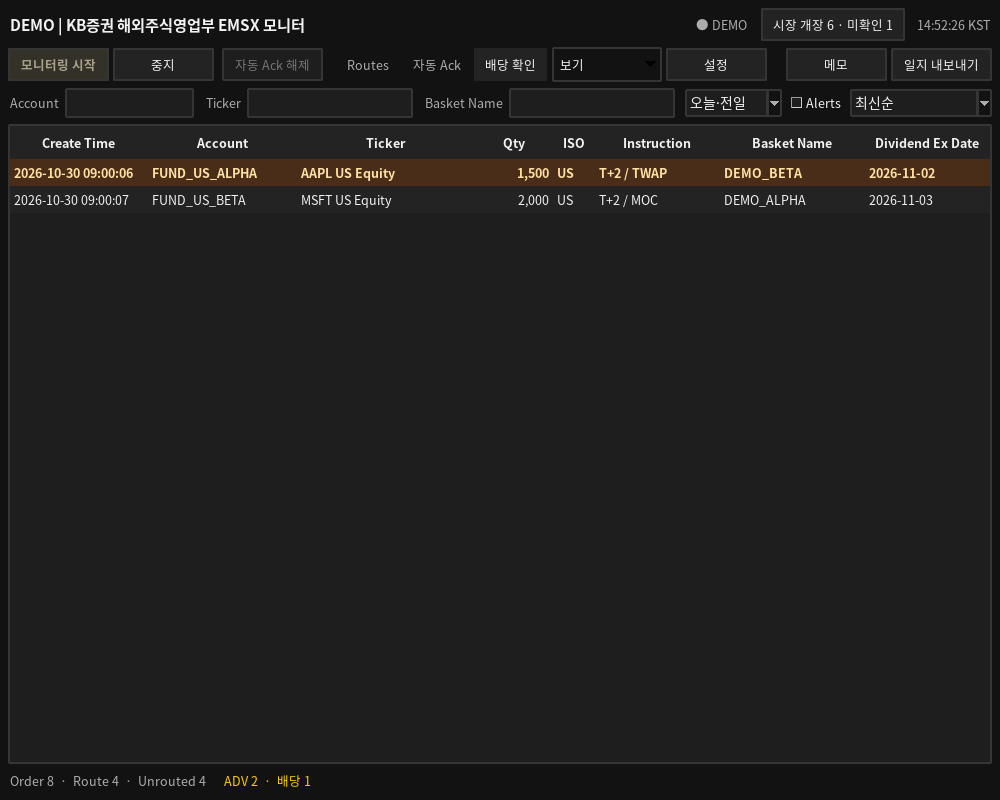

# 미국 T+2 배당 확인

2.9.0부터 자동 Ack 오른쪽의 **배당 확인** 탭을 제공합니다.
표에는 Create Time, Account, Ticker, Qty, ISO, Instruction, Basket Name,
Dividend Ex Date의 8개 열만 표시합니다. Qty는 Route 수량이 아닌 원래 Order 수량입니다.

## 대상과 우선 표시

기본 대상은 기존 날짜 범위에 포함된 미국 T+2 Order입니다.
ISO는 기존 DS290 발행국 코드가 `US`인 경우이며 Ticker 문자열로 국가를 추정하지 않습니다.
Instruction은 EMSX 고객 비고 `EMSX_NOTES`를 사용하며 대소문자와 관계없이 `T+2` 문자열이 포함되어야 합니다.

이 후보 중 `DVD_EX_DT`가 **KST 기준 다음 NYSE 영업일**과 정확히 같은 행을
갈색·금색 배경으로 강조하고 맨 위에 고정합니다.
최신순·과거순·Basket별 정렬을 바꾸어도 위험 행은 항상 먼저 표시합니다.
**Alerts**를 켜면 이 세 조건을 모두 만족한 행만 표시합니다.
Account·Ticker·Basket 검색과 오늘·전일 생성일 범위는 유지합니다.
이 화면에는 Broker 검색을 적용하지 않아 Route가 없는 Order도 확인할 수 있습니다.

## 익영업일 기준

기준일은 현재 서울 데스크의 KST 날짜입니다. Order 생성일이나 미국의 현재 현지 날짜로 대체하지 않습니다.
해당 KST 날짜의 다음 날부터 NYSE 거래일 달력을 확인해 주말·NYSE 휴장을 건너뜁니다.
조기 폐장일은 영업일에 포함합니다. 한국 공휴일 달력은 사용하지 않습니다.

| KST 기준일 | 다음 NYSE 영업일 | 처리 |
|---|---|---|
| 2026-10-30 금요일 | 2026-11-02 월요일 | 토·일 제외 |
| 2026-11-25 수요일 | 2026-11-27 금요일 | 추수감사절 제외·조기 폐장일 포함 |
| 2026-12-24 목요일 | 2026-12-28 월요일 | 성탄절·주말 제외 |

기본 NYSE 일정은 기존 `assets/market_sessions.json`의 2025–2027년 범위를 사용합니다.
미제공 기간·로딩 오류·일정 누락은 영업일을 임의로 계산하지 않고 강조를 보류합니다.
후보가 있으면 하단에 **배당 일정 확인**을 표시합니다.
기존 `market_calendar_overrides.json`의 미국 날짜별 지정도 다음 영업일 계산에 반영됩니다.
시장 배지의 새로고침과 기존 로컬 캘린더 관리 절차는 [운영 안내](OPERATIONS_KO.md)를 따릅니다.

KST 날짜가 바뀌거나 참조값이 갱신되면 대상 영업일·강조·우선 정렬을 다시 계산합니다.
따라서 이전 세션에서 강조되었던 행이 같은 조건을 계속 만족한다고 가정하지 않습니다.

## Bloomberg 배당락일

필드 ID `DV018`을 `//blp/apiflds`에서 확인하고 mnemonic `DVD_EX_DT`를
기존 `//blp/refdata` 요청에 포함합니다. EMSX Order·Route 구독 필드에는 추가하지 않습니다.
참조 요청은 기존 작업자에서 종목별 중복 제거·묶음 요청·5분 캐시 정책을 사용합니다.

날짜 객체, `YYYY-MM-DD`, `YYYYMMDD`를 `YYYY-MM-DD`로 정규화합니다.
None·권한 오류·잘못된 형식은 `—`로 표시하며 과거 값으로 대신 판정하지 않습니다.
개별 배당 필드 오류는 해당 확인만 보류하고 기존 주문 수신·자동 Ack 상태와 분리합니다.
참조 서비스 단절 시 저장된 배당락일도 미확인으로 되돌립니다.

## 기록과 내보내기

강조 시작·해제는 기존 데스크 일지에 기록합니다. 시작 기록에는 Order·Qty·Ticker·Instruction·ISO,
KST 기준일·대상 NYSE 영업일·수신 배당락일을 포함하며 같은 상태를 반복 기록하지 않습니다.
하단 배당 건수와 시각 강조로 확인하며 기존 Route 지연·No-Fill 음향 규칙은 유지합니다.
고객 안내를 위한 확인 화면이며 주문·결제일을 자동 변경하지 않습니다.

**보기 → 현재 화면 CSV 저장**은 현재 배당 화면의 필터·정렬과 8개 열을 저장합니다.
**일지 내보내기**는 기존 7개 Excel 시트를 유지하며 Order 현황에 Dividend Ex Date를 추가합니다.
배당 확인 화면에서 선택한 Order에 트레이더 메모를 연결할 수 있습니다.

## DEMO와 배포

DEMO에는 다음 영업일 배당락 T+2 Order, 그 이후 배당락 T+2 Order,
T+2 지시가 없는 미국 Order를 추가해 강조·정렬·제외 조건을 확인할 수 있습니다.
기존 `DemoWorker(output)`의 5개 기본 샘플은 유지하고 앱에서 배당 샘플을 함께 활성화합니다.

새 `dividend_rules.py`를 포함한 전체 소스를 교체하고 기존 명령으로 재빌드합니다.
설정·DB·wheelhouse는 보존하며 추가 패키지 설치는 필요하지 않습니다.

```bat
python windows_build.py build
```

총 255개 테스트와 Linux의 한국어 Tk 화면에서 날짜·휴장·정렬·필드 오류·CSV·실제 DEMO 종료를 검증했습니다.
실제 Bloomberg 필드 권한·응답과 Windows 실행 파일은 대상 PC에서 확인해야 합니다.


